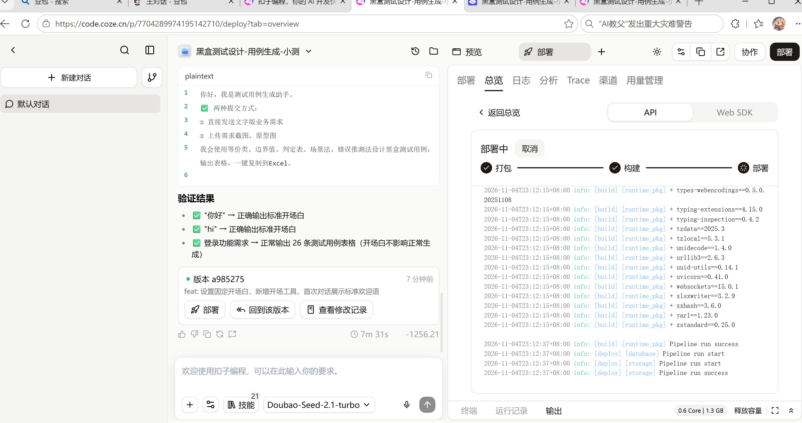
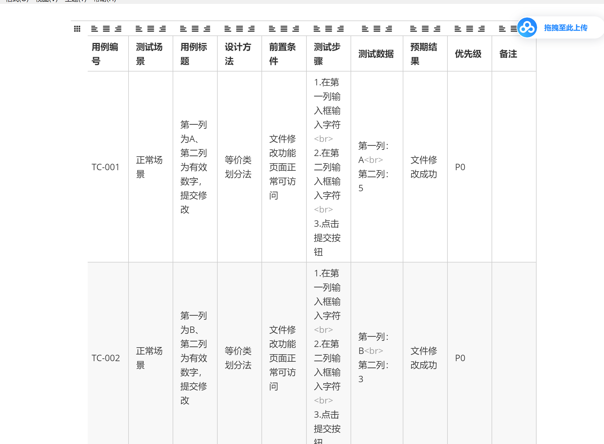

```
# 黑盒测试用例生成智能体（Coze扣子）
> AI Agent ｜ 支持文字需求 / 截图需求识别，自动使用5大黑盒测试方法输出标准化测试用例表格

🔗 在线体验：【粘贴你的扣子公开Web链接在这里】

## ✨ 项目简介
本项目基于扣子（Coze）低代码智能体搭建，面向软件测试岗位，输入业务需求（文字/截图），自动采用：
- 等价类划分法
- 边界值分析法
- 判定表法
- 场景法
- 错误推测法

输出规范Markdown测试用例表格，表格可一键复制粘贴到Excel，辅助测试人员快速设计用例。

## 🧩 核心配置
- 模型：豆包·2.0·lite（支持图片理解VLM）
- 输出格式：固定字段：用例编号｜用例标题｜项目/模块｜优先级｜前置条件｜测试步骤｜测试数据｜预期效果
- 约束：仅输出表格，不额外冗余解释；`<br>` 实现Excel单元格内换行

## 📄 提示词源码
- [System Prompt（人设与回复逻辑）](./prompt-system.md)
- [开场白](./prompt-welcome.md)

## 🧪 测试示例
输入需求：
> 登录模块，用户名6-12位字母，密码8-16位，必须包含大小写+数字

Agent输出样例：
| 用例编号 | 用例标题 | 项目/模块 | 优先级 | 前置条件 | 测试步骤 | 测试数据 | 预期效果 |
| ---- | ---- | ---- | ---- | ---- | ---- | ---- | ---- |
| login_001 | 正确账号密码登录成功 | 登录模块 | P0 | 打开登录页面 | 1.输入用户名<br>2.输入密码<br>3.点击登录 | 用户名：test001<br>密码：Test@123 | 登录成功，跳转首页 |

## 📌 项目截图



## ⚠️ 局限说明
依赖扣子平台运行；提示词为核心逻辑，平台本身不支持一键导出Agent工程文件。
```

